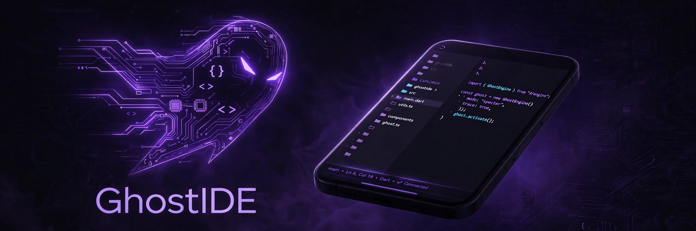

# GhostIDE for Android 👻

[](https://github.com/littlestjames82-sys/ghostide-android/actions/workflows/ci.yml)

**A mobile-first, AI-powered software development environment
with an integrated agent runtime and a governed developer
ecosystem — running entirely on the phone.**

GhostIDE is not a code viewer with a chat box. The editor,
the workspace, an in-app HTTP server, a llama.cpp inference
engine (JNI), a bundled CPython interpreter, a bundled git,
and 29 Ghost ecosystem tools all live inside the app. Models
download once into app-private storage and then work offline
forever.

**Your code never leaves the device. The AI lives here.**

**▶ Watch it run: [the 54-second demo](docs/media/ghostide-demo.mp4)** —
the real app, driven live: editor diagnostics on a real syntax
error, the git client, a live test run, the ecosystem catalog,
and the agent's approval controls. Narrated by Ryan.

| | |
|---|---|
| Package | `com.ghostide.app` |
| Current release | **3.10.0** (versionCode 215, Nov 2, 2026) |
| APK size | ~20.5 MB |
| Android | min SDK 24 · target SDK 36 · arm64 only |
| Signing | one preserved keystore across every build, so each release installs as an in-place update (cert SHA-256 `8ea8684a…`) |
| License | MIT |

The web IDE is the **same frontend bundle** as the desktop
[`ghost-ide`](https://github.com/littlestjames82-sys/ghost-ide)
repo — one behavior pack (`BEHAVIOR.md` there) drives both,
so the two editions cannot silently drift. Where only a
desktop can do something, the phone says so in plain words
instead of pretending.

---

## The editor

- Tabs with dirty markers, split view, breadcrumbs, outline,
  minimap-free distraction-free layout tuned for a phone
  screen — and a desktop-grade feature set underneath:
- **Live syntax diagnostics**: the current text is checked
  as you type (debounced), on save, and on tab switch; a
  broken line is marked in the gutter with the checker's own
  message, and a status-bar chip names the line and jumps
  to it. Compute-only — diagnostics never write a file.
- **Code folding** with gutter, keyboard shortcuts, and a
  Settings toggle, in both panes.
- Find & replace with case-sensitivity and regex modes,
  match navigation, per-file grouping, and **dry-run
  previews** that state exactly how many replacements a
  replace-all will make before it runs.
- Cursor positions and find text survive restarts; drafts
  are autosaved and recoverable; local history keeps
  earlier versions of every file.
- Command palette, recipes shelf, project templates,
  sandboxed plugins, import / export / share.

## The AI


- **On-device chat** with context modes (current file,
  smart slice, project slice via GhostSlice) against local
  Qwen2.5-Coder models — 0.5B Sprinter, 1.5B Balanced,
  3B Smarter, 7B Max — downloaded in a foreground service,
  resumable, exact-size and SHA-256 verified.
- **Agent mode** with staged writes and a diff review
  panel: nothing lands on disk until you approve it.
  The agent:
  - cannot declare DONE over broken staged code — every
    staged file is syntax-checked first, problems feed
    back as bounded repair rounds (you set the cap),
  - re-verifies on disk after you approve, and offers
    failures as a ready-made fix task,
  - detects repeated-action loops (warn at 3, stop at 4),
  - can Pause mid-run, queue follow-up tasks FIFO, keep a
    scratchpad, and dispatch read-only EXPLORE sub-runs,
  - works under step budgets you control, with a full run
    accounting trail.
- Autocomplete (ghost text), inline edits, error memory
  (past failures prime future runs), replayable session
  trails.
- Optional cloud providers can be configured; the default
  and the design center is local.

## Git — a complete daily client

Init, status with ahead/behind counts, stage, commit,
**branches** (create / switch / delete, current-branch
protected), **stash** (push incl. untracked, apply, pop,
drop), **tags** (mark HEAD or any commit from the commit
viewer), **amend**, worktrees, blame, log with a tap-to-view
commit inspector, remotes (fetch / pull / push), and an
AI commit-message assistant.

Every name, index, and hash the UI sends is pinned
server-side (branch/tag name regex, stash refs rebuilt
from a validated integer, commit hashes hex-pinned) — git
argument injection is refused at both servers, and the
agent's git surface is read-only by construction.

## Tests & verification

- Discover `test_*.py` / `*_test.py` / `*.test.js`, run a
  whole suite, one file, or **a single test by name**;
  re-run only the failures; the last run's verdict
  persists and rides a status-bar chip.
- Verify pipeline with evidence levels, whose problem
  lines are tappable and jump into the editor.
- On the phone build the test *runner panel* is
  desktop-only by design and says so honestly; Python
  files themselves run on-device via Run.

## The ecosystem: 29 bundled tools


The app bundles the Ghost tool suite (bundle generation
**e13**, extracted on first run) and executes the *real
tools* against your workspace — never reimplementations.
2,871 tool tests pass in the bundle gate.

| Tool | What it does |
|---|---|
| GhostSlice 1.0.6 | Agent context optimizer: token-cost tree, AST slicer, pre-flight cost estimator |
| GhostApprove | One local approval queue for the Ghost stack |
| GhostAtlas | Human codebase map: visual module map, reading order, architecture brief |
| GhostConsole | Offline HTML board aggregating every tool's latest reports |
| GhostConvert | Turn a Slice bundle into AGENTS.md, Cursor rules, Copilot instructions |
| GhostData | Structured-data slicer: schema inference + bounded, redacted samples |
| GhostDeps | Dependency context pack: manifests cross-referenced against real imports |
| GhostDocs | GhostSlice for non-code corpora: scan, dedupe, slice, export documents |
| GhostEnv | .env doctor: names used vs defined vs documented — names only, never values |
| GhostExposure | Audit bundles with proof of exclusion |
| GhostFixture | Minimal repro project generator from a Slice bundle |
| GhostHandoff | Session handoff pack: git state, changes, verification status, open loops |
| GhostIndex | Cross-project local search index (sqlite FTS5) |
| GhostLeads | Offline lead manager and scorer for local businesses |
| GhostLedger | Local token and cost ledger per project |
| GhostLift | Lift compiled/minified artifacts back to readable source |
| GhostLogs | Log slicer: error windows, deduped repeats, incident packs |
| GhostMCP 0.3.2 | Ghost-native MCP client: list servers, list tools, call tools |
| GhostMCP Doctor | Read-only auditor for MCP / agent-client configs |
| GhostPrimer | First-session starter bundle: code slice + project-memory primer |
| GhostRE | Ghost-native binary inspector: format ID, headers, imports, entropy, strings |
| GhostRecall | Project memory slicer: decisions, docs, git history in a checkable bundle |
| GhostRecipes | Versioned, data-only workflow recipes and checklists |
| GhostReplay | Agent session learner: analyses transcripts, proposes improvements |
| GhostReview | Plain-English verdict layer for diffs |
| GhostSchema | Slice large API specs (OpenAPI, JSON Schema, GraphQL) to what matters |
| GhostScope | PR/diff review slicer: blast radius, risk reasons, coverage |
| GhostShard | Planner-only multi-agent task sharder |
| QuoteShot | Offline photo-to-quote workflow for trades work |

## Pair mode

Join a desktop GhostIDE workspace from the Models screen:
token-paired (tokens expire in 12 hours, viewers are
read-only), with conflict-safe sync. The desktop can also
be driven from the phone — the same UI, the same tools.

## Backups & data safety

Encrypted backups (AES-256-GCM, PBKDF2-HMAC-SHA256) in the
same format as the desktop build. Restores are **staged,
validated, and applied with rollback copies** — an
untrusted archive is never extracted straight into a
workspace. ZIP traversal is defended and duplicate archive
entries are rejected. All file writes on both servers are
atomic (temp sibling + atomic rename).

## Voice

System speech recognition into chat or the editor, plus
spoken commands ("save file", "run it", "Ask Ghost …").

---

## Documentation

- [docs/ARCHITECTURE.md](docs/ARCHITECTURE.md) — how the
  app is put together: native shell, server, runtimes,
  ecosystem bundle, pair mode.
- [docs/SECURITY.md](docs/SECURITY.md) — the security
  model: loopback binding, pairing, validation pins,
  backup crypto, agent rails.
- [docs/TESTING.md](docs/TESTING.md) — how a build earns
  the right to ship: harness suite, bundle gate, eco
  gate, version gate.
- [BUILDING.md](BUILDING.md) — the manual build recipe.
- [BUILD_NOTES.md](BUILD_NOTES.md) — the complete
  per-version engineering record.
- [store/LISTING.md](store/LISTING.md) — store launch
  checklist and gates.

## Build

Manual recipe (no Gradle): `build.sh` runs aapt2 + javac +
d8 + zipalign + apksigner from the Android SDK build-tools,
signing with the preserved debug keystore so every build
installs as an in-place update. `check_versions.py` refuses
a build whose five version sources disagree. Prerequisites
not in this repo: Android SDK build-tools, JDK 17, the
llama `.so` libraries, and (for release) bundletool.

Release builds (Play): `build-release.sh` produces a signed
`.aab` with the production upload key plus a universal
tester APK. The keystore and its password live outside
this repo.

## Repository layout

```
app/src/main/java/com/ghostide/app/   the IDE server + services
  IdeServer.java     HTTP API (loopback), ~7,600 lines with
                     GitSupport, PairHub and the eco runner
  GitSupport.java    git execution behind the pin discipline
  PairHub.java       desktop pairing + sync
  BackupService.java staged, validated backup restore
  BackupCrypto.java  AES-256-GCM / PBKDF2
  ZipGuard.java      archive traversal + duplicate defense
  DownloadService.java  model downloads (foreground service)
  Models.java        the model store catalog
app/src/main/java/com/ghostbot/app/
  LlamaBrain.java    JNI bridge to llama.cpp (name is load-
                     bearing — see BUILD_NOTES.md)
app/src/main/assets/www/   the shared web frontend bundle
python-runtime/      CPython + git runtime staging
tests/jvm/           JVM-side tests for the Java server
docs/                architecture, security, testing
```

## Status — stated plainly

- GhostIDE is distributed today as a direct APK from the
  developer; **it is not on the Play Store yet**. The store
  launch has its own checklist and gates
  ([store/LISTING.md](store/LISTING.md)).
- Features are proven in layers: the Java server compiles
  and is pin-tested for every route, the desktop edition
  proves behavior live against fixtures, and a stacked
  on-device pass covers the newest cycles on the current
  build. The per-version record in BUILD_NOTES.md states,
  for each feature, exactly which layer proved it.
- Development runs in audited cycles: improvement batches
  alternate with adversarial audit batches against a
  standing A1–A20 checklist, and the audit machinery has
  repeatedly caught real drift *during* improvement work,
  not after it.

MIT licensed. Built by Ghost Developer Studio, Oakdale,
Tennessee.
